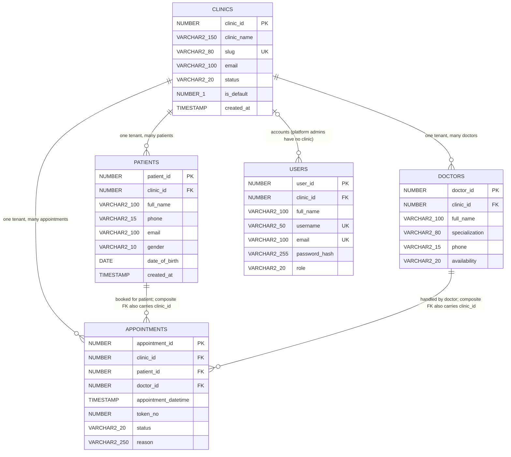

# MediFlow ER diagram

The schema has **five tables**. `clinics` is the tenant root; every clinical row
carries `clinic_id`, and the app always scopes queries by the clinic id stored
in the signed Flask session.

- [`er-diagram.svg`](er-diagram.svg) — ready-to-view vector diagram (open in any browser).
- [`er-diagram.mmd`](er-diagram.mmd) — editable Mermaid source.

## Diagram (Mermaid)

## Relationships

| Parent | Child | Foreign key | Cardinality |
|---|---|---|---|
| `clinics` | `patients` | `patients.clinic_id` | 1 clinic → 0..* patients |
| `clinics` | `doctors` | `doctors.clinic_id` | 1 clinic → 0..* doctors |
| `clinics` | `appointments` | `appointments.clinic_id` | 1 clinic → 0..* appointments |
| `clinics` | `users` | `users.clinic_id` | 1 clinic → 0..* users (NULL for platform admins) |
| `patients` | `appointments` | `appointments.patient_id` **and** `(patient_id, clinic_id)` | 1 patient → 0..* appointments |
| `doctors` | `appointments` | `appointments.doctor_id` **and** `(doctor_id, clinic_id)` | 1 doctor → 0..* appointments |

## Important constraints

- **Composite tenant FKs** on `appointments` prevent a booking from joining a
  patient or doctor in a different clinic:
  - `(patient_id, clinic_id)` → `patients(patient_id, clinic_id)`
  - `(doctor_id, clinic_id)` → `doctors(doctor_id, clinic_id)`
- **Role/scope check** on `users`:
  - `ADMIN` / `PLATFORM_ADMIN` ⇒ `clinic_id IS NULL` (global platform view)
  - `CLINIC_ADMIN` / `RECEPTIONIST` / `DOCTOR` ⇒ `clinic_id IS NOT NULL`
- **Unique keys**: `clinics.slug`; `patients(clinic_id, phone)`;
  `doctors(clinic_id, NVL(phone, 'NO-PHONE-' || doctor_id))`;
  `appointments(doctor_id, appointment_datetime, token_no)`;
  `users.username`, `UPPER(users.username)`, `LOWER(users.email)`.
- **Check constraints**: clinic `status`, doctor `availability`, appointment
  `status`, and user `role` are restricted to fixed value lists.
- There is deliberately **no FK from `appointments` to `users`** — bookings are
  clinical records, not tied to a login account.

Source of truth: `sql/01_schema.sql` plus `sql/05_auth_and_availability_migration.sql`,
`sql/06_multi_tenant_migration.sql`, and `sql/08_optional_doctor_phone_migration.sql`.
